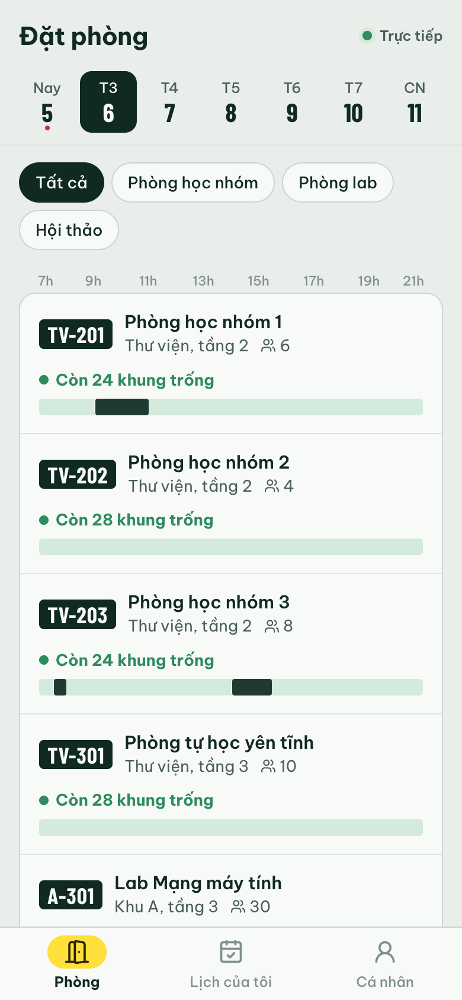
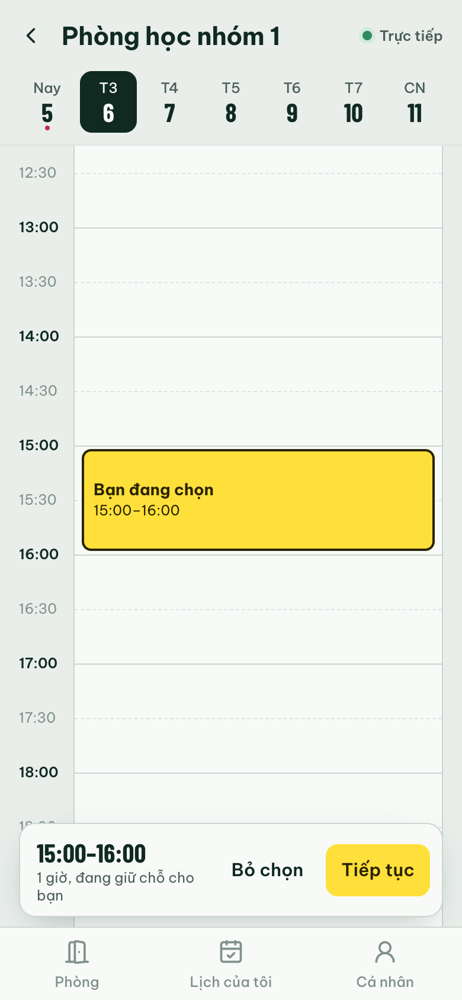
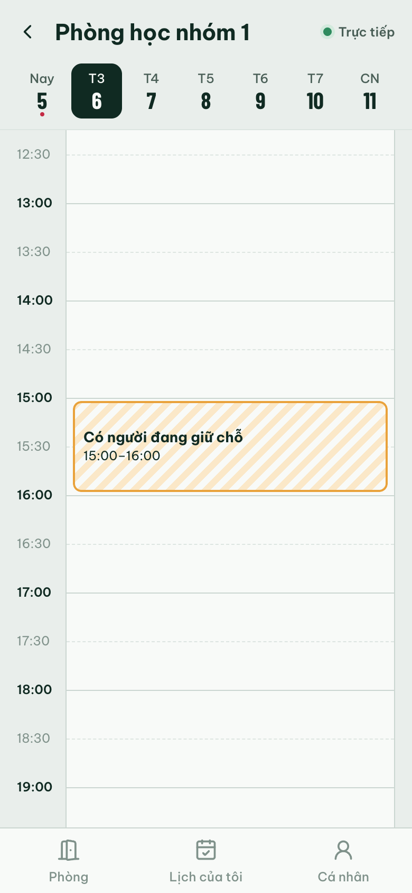
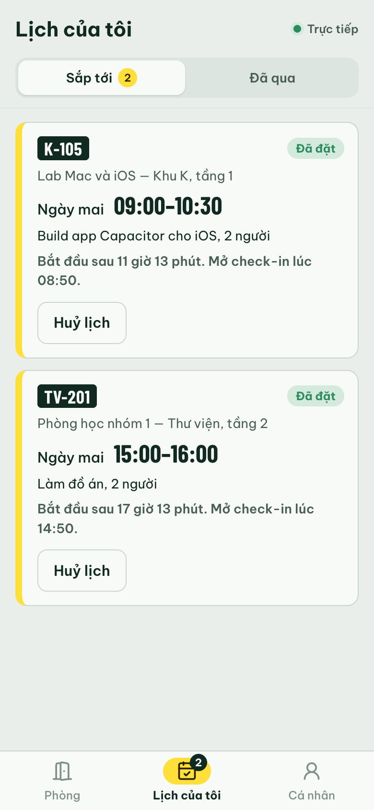
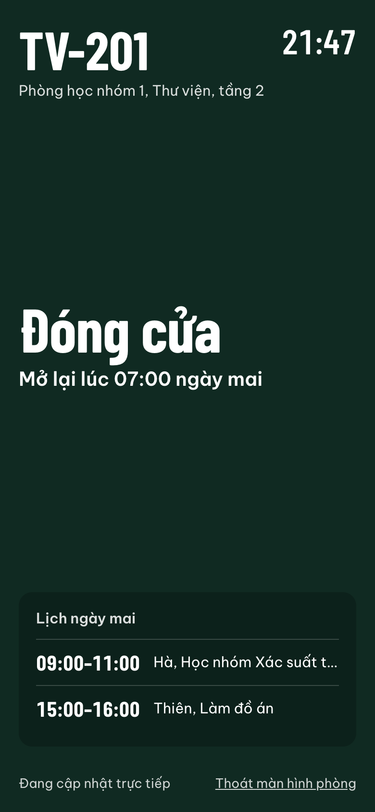

# Đặt Phòng VKU — Đặt phòng học / lab realtime (Capacitor) — Project 2

Ứng dụng đặt phòng học nhóm và phòng lab theo mô hình **Robin / LibCal**, chạy trên
**Web, Android, iOS** từ một codebase React + Capacitor. Ai vừa đặt hay đang giữ
một khung giờ, mọi thiết bị khác thấy ngay qua **Socket.IO**; server là nguồn sự
thật duy nhất nên không bao giờ có hai lịch trùng giờ.

**Bản chạy thử:** https://mini-project3-ltdnt.vercel.app (web + server realtime trên Vercel,
dữ liệu trong Upstash Redis) — màn hình cửa phòng: https://mini-project3-ltdnt.vercel.app/display/TV-201

| Danh sách phòng | Đang chọn giờ | Người khác thấy | Lịch của tôi | Màn hình cửa phòng |
|---|---|---|---|---|
|  |  |  |  |  |

## Tính năng

- **Trạng thái phòng theo thời gian thực**: danh sách 8 phòng (học nhóm, lab, hội
  thảo), mỗi phòng có dải lịch 07:00–21:00 với vạch "bây giờ", nhãn *Trống đến
  10:30* / *Đang dùng đến 11:00*. Ô vừa bị người khác thay đổi sẽ nháy để báo.
- **Đặt theo khung 30 phút** trên lưới giờ: chạm ô trống để chọn, chạm tiếp để kéo
  dài (tối đa 2 giờ). Lọc theo loại phòng, "Trống bây giờ", chọn ngày (7 ngày tới).
- **Giữ chỗ tạm 2 phút** (kiểu LibCal): vừa chọn giờ là server giữ khung đó cho
  bạn trong lúc điền form; người khác thấy khung sọc cam *Có người đang giữ chỗ*
  và không chọn được. Hết giờ, rời trang hoặc mất kết nối thì tự nhả.
- **Chống đặt trùng**: kiểm tra trùng lịch, trùng giữ chỗ, trùng lịch của chính
  mình ở phòng khác, giới hạn 3 lịch chưa dùng — tất cả trên server.
- **Check-in và tự nhả phòng** (kiểu Robin): check-in mở trước giờ bắt đầu 10
  phút; quá 15 phút đầu chưa check-in thì phòng tự được nhả cho người khác và
  người đặt nhận thông báo. Có nút **Trả phòng sớm** để nhả phần còn lại.
- **Lịch của tôi đồng bộ đa thiết bị**: đăng nhập cùng MSSV trên điện thoại và
  trình duyệt, đặt / huỷ / check-in ở máy này thì máy kia cập nhật ngay.
- **Nhắc lịch** bằng `@capacitor/local-notifications` (lúc mở check-in và 5 phút
  trước khi hết hạn); trên web nhắc bằng thông báo trong app.
- **Offline**: danh sách phòng và lịch của tôi được cache bằng
  `@capacitor/preferences`; `@capacitor/network` báo mất mạng, khoá thao tác đặt
  và tự kết nối lại + tải lại dữ liệu khi có mạng / khi app quay lại foreground.
- **Màn hình trước cửa phòng** (`/display/:mã-phòng`, kiểu Robin Room Display):
  nền xanh / đỏ / cam theo trạng thái, ai đang dùng, lịch tiếp theo — không cần
  đăng nhập, để trên máy tính bảng cạnh cửa.
- **Sinh viên ảo**: server có vài người dùng demo tự giữ chỗ, đặt, huỷ, check-in
  (và một người "hay quên" để minh hoạ tự nhả phòng) — test một mình vẫn thấy
  realtime. Tắt bằng `DEMO_BOTS=off`.
- Giao diện mobile-first (tối đa 480px), light / dark mode, font tiếng Việt
  (Be Vietnam Pro, Barlow Condensed) đóng gói sẵn để chạy offline.

## Kiến trúc

```
 Điện thoại / trình duyệt (React + Capacitor)              Server (Node + Express + Socket.IO)
┌──────────────────────────────────────────┐            ┌──────────────────────────────────────┐
│ pages/  ─► hooks/useRealtime (useSync-    │  REST      │ GET /api/rooms                         │
│            ExternalStore)                 │──────────► │                                        │
│ store/realtime.ts  ── socket.io-client ───┼──────────► │ BookingEngine: nạp state → nghiệp vụ  │
│   cache: Preferences  ◄── booking:upsert  │ ◄──────────│   → ghi có kiểm tra phiên bản (CAS)   │
│   Network / App plugin → reconnect        │   hold:*   │ store: bộ nhớ + data.json (local)     │
│   LocalNotifications, Haptics             │            │        Upstash Redis (Vercel)          │
└──────────────────────────────────────────┘            └──────────────────────────────────────┘
                    shared/  (types, quy định đặt phòng, giờ campus UTC+7, giao thức) — dùng chung 2 phía
```

```
shared/
  types.ts          Room, Booking, Hold, User
  rules.ts          Quy định (30 phút, tối đa 2 giờ, 3 lịch, 7 ngày, check-in 10/15 phút), validateSlot, bookingPhase
  time.ts           Giờ campus cố định UTC+7 — không phụ thuộc múi giờ điện thoại / server
  protocol.ts       Kiểu sự kiện Socket.IO (client -> server có ack, server -> client)
server/
  realtime.ts       Express + Socket.IO, phát thay đổi tới room "day:<ngày>" và "user:<MSSV>"
  engine.ts         Chạy mỗi thao tác: nạp state -> BookingService -> ghi CAS, xung đột thì thử lại
  bookingService.ts Giữ chỗ, đặt, huỷ, check-in, trả phòng sớm, sweep no-show
  store.ts          MemoryStore (local, server/data.json) và RedisStore (Vercel)
  demoBots.ts       Sinh viên ảo
  seed.ts           Dữ liệu mẫu
  index.ts          Chạy local (npm run server)
api/server.ts       Vercel Function: cùng server, export http.Server
vercel.json         Build Vite + chuyển /api/* về function, region sin1
src/
  store/realtime.ts Kết nối socket, snapshot theo ngày, cache offline, lệnh có timeout
  services/         config (địa chỉ server), session, storage, notifications, haptics
  pages/            Login, Rooms, RoomDetail, MyBookings, Profile, RoomDisplay
  components/       DateStrip, DayTimeline, SlotGrid, BookingSheet, BookingCard, ConnectionBanner, …
android/, ios/      Project native do Capacitor sinh ra
```

Client và server dùng chung `shared/` bằng TypeScript; server local chạy thẳng
file `.ts` nhờ type stripping của Node (≥ 22.18), không cần bước build.

**Chống đặt trùng khi có nhiều instance**: mỗi thao tác nạp toàn bộ state, chạy
logic đồng bộ trong `BookingService`, rồi ghi lại bằng một script Lua
compare-and-set trên Redis. Instance khác ghi trước thì phiên bản đã đổi → nạp
lại và chạy lại. Sự kiện chỉ được phát sau khi ghi thành công; Socket.IO Redis
adapter chuyển sự kiện tới client đang kết nối ở mọi instance.

### Giao thức realtime

| Client gửi (kèm ack) | Ý nghĩa |
|---|---|
| `day:join(date)` / `day:leave` | Theo dõi một ngày, nhận snapshot lịch + giữ chỗ |
| `hold:create(slot)` / `hold:release` | Giữ / nhả khung giờ đang chọn |
| `booking:create` / `cancel` / `checkin` / `end` | Đặt, huỷ, check-in, trả phòng sớm |
| `mine:list` | Lịch của tôi |

| Server phát | Tới |
|---|---|
| `booking:upsert`, `hold:upsert`, `hold:remove` | Ai đang xem ngày đó + mọi thiết bị của chủ lịch |
| `notice` | Chủ lịch (ví dụ: lịch đã tự huỷ vì không check-in) |
| `presence` | Mọi người (số thiết bị đang kết nối) |

## Cài đặt và chạy trên web

```bash
npm install
npm run server     # server realtime: http://localhost:4000 (tự restart khi sửa code)
npm run dev        # app: http://localhost:5173
```

Mở hai cửa sổ ẩn danh, đăng nhập hai MSSV khác nhau, cùng mở một phòng: chọn giờ
ở cửa sổ này sẽ thấy khung "đang giữ chỗ" xuất hiện ở cửa sổ kia.

Chạy một tiến trình duy nhất (server phục vụ luôn bản build web):

```bash
npm run build && npm start   # http://localhost:4000
```

## Deploy lên Vercel

```bash
vercel link
vercel integration add upstash/upstash-kv --plan free -m primaryRegion=sin1   # tạo Redis, tự thêm REDIS_URL / KV_URL
vercel deploy --prod
```

- Web (bản build Vite) phục vụ dạng file tĩnh; `api/server.ts` chạy Express +
  Socket.IO trên Vercel Functions (Fluid Compute, hỗ trợ WebSocket).
- Socket.IO chỉ dùng transport `websocket` (Vercel không hỗ trợ long-polling).
  Gói Hobby đóng mỗi kết nối sau 300 giây; client tự kết nối lại và tải lại
  snapshot, banner chỉ hiện nếu mất kết nối quá 3 giây.
- Vercel biên dịch `api/server.ts` bằng `tsconfig.json` gốc, trong đó bật
  `rewriteRelativeImportExtensions` để import `./x.ts` thành `./x.js`.

## Chạy trên Android / iOS

```bash
npm run cap:android   # build web -> cap sync -> mở Android Studio
npm run cap:ios       # build web -> cap sync -> mở Xcode (cần cài Xcode)
```

- **Địa chỉ server**: Android emulator tự dùng `http://10.0.2.2:4000`, iOS
  simulator dùng `http://localhost:4000`. Trên **điện thoại thật**, vào tab
  **Cá nhân → Máy chủ realtime** nhập `http://<IP-LAN-của-máy-tính>:4000` (máy
  tính và điện thoại cùng Wi-Fi) — không cần build lại. Muốn dùng server đã
  deploy thì nhập `https://mini-project3-ltdnt.vercel.app`. Hoặc đặt
  `VITE_SERVER_URL` trong `.env` (xem `.env.example`).
- **JDK cho Android**: Capacitor 8 cần **JDK 21**. JDK đi kèm Android Studio mới
  (Java 25) không chạy được Gradle 8.14 — vào *Settings → Build, Execution,
  Deployment → Build Tools → Gradle → Gradle JDK* chọn / tải một JDK 21.
- **HTTP trong mạng LAN**: server demo không có HTTPS nên đã bật
  `android:usesCleartextTraffic` + `allowMixedContent` (Android) và
  `NSAppTransportSecurity` (iOS). Bản thật nên dùng HTTPS và bỏ các ngoại lệ này.

## Kiểm thử

```bash
npm test        # 34 test: giờ campus, quy định đặt phòng, BookingService, BookingEngine nhiều instance
npm run lint
npm run build   # tsc -b (app + server) + vite build
```

## Plugin Capacitor đã dùng

| Plugin | Mục đích |
|---|---|
| `@capacitor/preferences` | Phiên đăng nhập, địa chỉ server, cache phòng và lịch của tôi |
| `@capacitor/network` | Phát hiện mất mạng, ngắt / nối lại socket |
| `@capacitor/app` | App quay lại foreground thì kết nối lại và tải lại dữ liệu |
| `@capacitor/local-notifications` | Nhắc check-in trước giờ và trước khi hết hạn |
| `@capacitor/haptics` | Rung khi đặt thành công / lỗi |
| `@capacitor/status-bar` | Style status bar trên native |

## Giới hạn của bản demo

- Đăng nhập chỉ bằng họ tên + MSSV, chưa xác thực; server tin `userId` gửi lên.
- Toàn bộ state nằm trong một khoá Redis và ghi theo kiểu optimistic locking —
  hợp với quy mô demo; nhiều người dùng hơn nên chuyển sang database có ràng
  buộc chống trùng khoảng thời gian (ví dụ Postgres `EXCLUDE USING gist`).
- Nhắc lịch là thông báo cục bộ trên máy; muốn báo "lịch bị tự huỷ" khi app đã
  đóng cần push notification từ server (FCM / APNs).
